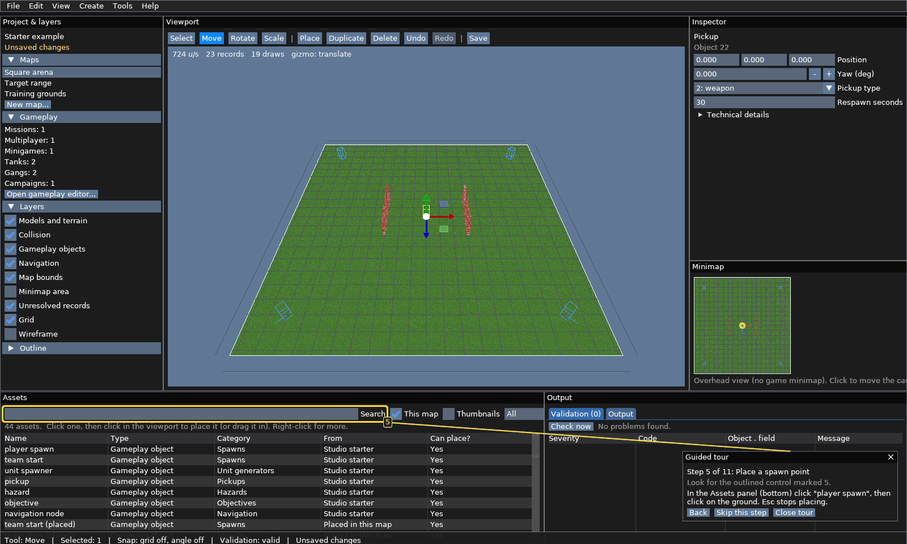
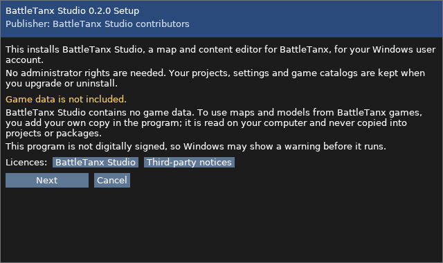

# BattleTanx Studio

BattleTanx Studio is a desktop map and content editor for BattleTanx and
BattleTanx: Global Assault. It uses one neutral resource model for:

- BattleTanx (Nintendo 64)
- BattleTanx: Global Assault (Nintendo 64)
- BattleTanx: Global Assault (PlayStation)

The repository contains the graphical editor, deterministic asset decoders,
map semantics, non-destructive edit overlays, glTF export, comparison tools,
and synthetic tests. It does **not** contain ROMs, disc images, extracted game
assets, or generated previews. Supply game data you legally control locally.

## For players and map makers (Windows)

Download `BattleTanxStudioSetup.exe` from the Releases page and run it. The
per-user installer needs no administrator access and adds normal Start menu and
Windows Settings entries. A portable `BattleTanxStudio-portable-x64.zip` is
also available. Neither option needs Python, a terminal, or game files. The
welcome screen offers **Create Original Project**, **Import From My Games**,
**Open Existing Project** and **Open Example Project**; press F1 for help.
`README.txt` in the download explains installation, storage locations, and
problem reporting.



*Place and edit gameplay objects directly in the 3D viewport. The screenshot
uses the included synthetic starter project and contains no game data.*



*The per-user Windows setup requires no administrator access and clearly keeps
game data separate from Studio.*

## For developers

Python 3.11 or newer is recommended.

```bash
python -m venv .venv
. .venv/bin/activate                         # Windows: .venv\Scripts\activate
python -m pip install -r tools/btga_studio/requirements.txt
python -m tools.btga_studio.samples samples/sample-catalog \
  --project samples/sample.btgaproj
python -m tools.btga_studio --catalog samples/sample-catalog
```

The sample catalog is synthetic and contains no game data. Its generated files
are ignored by Git.

The repository also includes an original, ROM-free starter project at
`examples/starter-example.btgaproj` for exercising map, mission, multiplayer,
and minigame authoring without proprietary assets.

## Projects and local sources

Studio projects are versioned, deterministic JSON files. They can contain
multiple maps, campaigns, missions, multiplayer definitions, minigames, tanks,
gangs, minimap settings, and per-map undo history. Imported resources are
referenced by content ID and source hash rather than copied into the project.

The Source Manager can register locally owned BattleTanx N64, BattleTanx:
Global Assault N64, and BattleTanx: Global Assault PlayStation sources.
Registered paths and derived catalogs stay in the user's local data directory.

Validated projects export as deterministic custom-content packages. See the
[content package contract](docs/CONTENT_PACKAGE.md) for details.

## Tests

The default suite uses synthetic fixtures and requires no game data:

```bash
python -m unittest discover -s tests -p 'test_*.py'
```

Optional real-data gates are enabled only when their documented environment
variables point to locally owned source material. See the format documents in
[`docs/`](docs/) and the test modules for the exact variables.

## Build for Windows

Run from a PowerShell prompt with Python 3.13 installed:

```powershell
powershell -ExecutionPolicy Bypass -File tools\btga_studio\packaging\build_windows.ps1
```

The PyInstaller build uses the Windows GUI subsystem, so the packaged editor
does not open an additional command window. Details are in
[`docs/BTGA_STUDIO_EDITOR.md`](docs/BTGA_STUDIO_EDITOR.md).

## Design constraints

- Source assets remain read-only. Projects store deterministic overlays.
- Unknown fields and unresolved records are retained rather than guessed away.
- Resource IDs are stable and content-derived.
- Asset extraction output and private paths must never be committed.
- The editor does not write modified ROM or disc images.

## Documentation

- [Editor workflow and controls](docs/BTGA_STUDIO_EDITOR.md)
- [Studio resource API](docs/STUDIO_RESOURCE_API.md)
- [Custom-content package contract](docs/CONTENT_PACKAGE.md)
- [Neutral resource contract](docs/PS1_RESOURCE_CONTRACT.md)
- [N64 asset formats](docs/N64_ASSET_FORMATS.md)
- [PlayStation asset formats](docs/PS1_ASSET_FORMATS.md)

## License

See [COPYING](COPYING). BattleTanx names and game assets belong to their
respective owners and are not distributed by this project.
